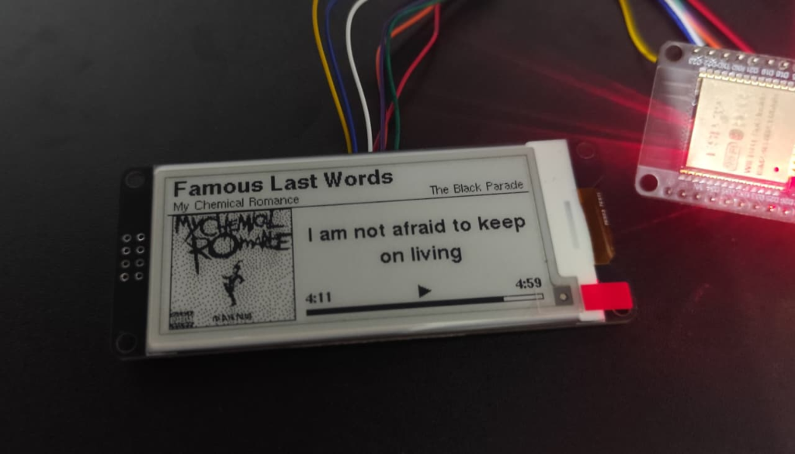

# SpotifyDesk 🎵

> **Dual-Mode E-Paper Spotify Display with Real-Time Synced Lyrics & Dithered Album Art for ESP32**



**SpotifyDesk** transforms a 2.9" E-Paper display and an ESP32 into a dedicated, aesthetic desktop music display. It showcases your currently playing track, dynamic synchronized lyrics (verse-by-verse), beautifully dithered album cover art, playback duration, and progress bar with zero eye strain and ultra-low power consumption.

This repository features **two distinct architectures** tailored to different setups:
1. **Version 1 (Desktop Companion)**: PC-assisted daemon running in the background of your Windows machine, reading media directly from the Windows OS session and streaming updates over USB Serial. Works with **both Spotify Free and Premium**, and even works with YouTube and local media players!
2. **Version 2 (Standalone Wi-Fi ESP32)**: Completely PC-free and independent. The ESP32 connects directly to your Wi-Fi network, queries the **Spotify Web API** over persistent HTTPS (keep-alive), streams synchronized lyrics from **LRCLIB**, and renders everything autonomously using a dual-core FreeRTOS architecture.

---

## 📸 Overview & Hardware Preview

As shown in the image above:
* **Track Title & Metadata**: Prominently displayed with elegant typography via `U8g2_for_Adafruit_GFX`.
* **Crisp Album Artwork**: 96×96 monochrome bitmap rendered with continuous sub-pixel area averaging downscaling and mean-centered Floyd-Steinberg error diffusion dithering (99.97% identical to Python PIL).
* **Live Synced Lyrics**: Centered, auto-wrapped line-by-line display synced down to the millisecond with the vocalist via LRCLIB. Displays a musical note symbol (`♪`) during musical solos or intros.
* **Playback Transport**: Current elapsed time, play/pause state indicator, track duration, and smooth progress bar.

---

## ⚡ Architectural Comparison

| Feature | **V1 — Desktop Companion** | **V2 — Standalone ESP32** |
|---|---|---|
| **Directory** | [`SpotifyDesk_V1/`](SpotifyDesk_V1/) | [`SpotifyDesk_V2/`](SpotifyDesk_V2/) |
| **PC Required?** | **Yes** (Lightweight Python background daemon) | **No** (Standalone ESP32 connected to 5V wall charger) |
| **Connection** | USB Serial (COM port, auto-detecting) | Wi-Fi 2.4 GHz (WPA/WPA2) directly to Internet |
| **Spotify Account** | **Free & Premium** (No Developer App needed) | **Spotify Premium** (Required by Spotify Developer API) |
| **Supported Audio Sources** | Spotify Desktop, Web Player, YouTube, iTunes, VLC | Any device playing on your Spotify account (Phone, PC, Smart TV, Tablet) |
| **Processing Power** | Host PC CPU handles PIL dithering & parsing | ESP32 Dual-Core (Core 0: Network & Art, Core 1: Display loop) |
| **Refresh Latency** | `LYRIC_LEAD_MS = 800` (Compensates for serial transfer) | `LYRIC_LEAD_MS = 0` (Local millisecond precision on ESP32 Core 1) |

---

## 🛠️ Hardware Requirements

* **Microcontroller**: DOIT ESP32 DevKit V1 (ESP-WROOM-32, 30-pin or 36-pin)
* **Display**: WeAct Studio 2.9" Monochrome E-Paper Module
  * Resolution: 296 × 128 pixels
  * Controller: SSD1680 (B/W, supports fast partial refresh ~250ms)
  * Interface: 4-wire SPI
* **Cables**: Female-to-Female or Female-to-Male jumper wires, Micro-USB cable

### Pin Wiring Diagram

| E-Paper Pin | ESP32 DOIT Pin | GPIO Pin | Description |
|---|---|---|---|
| **3.3V / VCC** | `3V3` | 3.3V | 3.3V DC Power Supply |
| **GND** | `GND` | GND | Ground |
| **SCL / SCK** | `D18` | GPIO 18 | Hardware SPI Clock |
| **SDA / MOSI** | `D23` | GPIO 23 | Hardware SPI MOSI (Master Out Slave In) |
| **CS** | `D5` | GPIO 5 | SPI Chip Select |
| **DC** | `TX2` | GPIO 17 | Data / Command Control |
| **RES** | `RX2` | GPIO 16 | Hardware Reset |
| **BUSY** | `D4` | GPIO 4 | Busy Status Signal |

---

## 📚 Required Arduino Libraries

Ensure the following libraries are installed in Arduino IDE (**Sketch → Include Library → Manage Libraries...**):

1. **GxEPD2** by *Jean-Marc Zingg* (v1.5.0 or newer) — Display driver for SSD1680
2. **Adafruit GFX Library** by *Adafruit* — Core graphics primitives
3. **U8g2_for_Adafruit_GFX** by *olikraus* — High-quality anti-aliased font rendering
4. **ArduinoJson** by *Benoit Blanchon* (**Version 7.x required**) — High-performance JSON streaming
5. **JPEGDEC** by *Larry Bank* (v1.2.8 or newer) — Ultra-fast JPEG decoder with scaling support

---

## 🚀 Quick Start Guide

### Option A: Setting Up Version 2 (Standalone Wi-Fi ESP32)

1. **Create a Spotify Developer Application**:
   * Visit the [Spotify Developer Dashboard](https://developer.spotify.com/dashboard) and log in.
   * Click **Create app**:
     * **App Name**: `SpotifyDesk`
     * **App Description**: `ESP32 E-Paper Music Display`
     * **Redirect URIs**: `http://127.0.0.1:8888/callback` *(Must match exactly!)*
     * Check the Developer Terms of Service and click **Save**.
   * In your app settings, note down your **Client ID** and **Client Secret**.

2. **Retrieve OAuth2 Refresh Token (One Click)**:
   * Open a terminal in `SpotifyDesk_V2/`:
     ```bash
     cd SpotifyDesk_V2
     python get_refresh_token.py
     ```
   * Enter your Client ID and Client Secret when prompted.
   * Your browser will automatically open to log into Spotify and authorize the read-only scope.
   * The script automatically saves your credentials into `SpotifyDeskV2/config.h`!

3. **Configure Wi-Fi**:
   * Open [`SpotifyDeskV2/config.h`](SpotifyDesk_V2/SpotifyDeskV2/config.h) and set your Wi-Fi credentials:
     ```cpp
     #define WIFI_SSID     "Your_WiFi_Network"
     #define WIFI_PASSWORD "Your_WiFi_Password"
     ```

4. **Upload Sketch**:
   * Open [`SpotifyDeskV2/SpotifyDeskV2.ino`](SpotifyDesk_V2/SpotifyDeskV2/SpotifyDeskV2.ino) in Arduino IDE.
   * Select Board: **DOIT ESP32 DEVKIT V1**.
   * Click **Upload**. Enjoy your standalone desktop companion!

---

### Option B: Setting Up Version 1 (Desktop Companion via PC)

1. **Install Python Dependencies**:
   ```bash
   cd SpotifyDesk_V1
   pip install -r requirements.txt
   ```

2. **Upload ESP32 Receiver Firmware**:
   * Open [`SpotifyDesk_V1/SpotifyDesk/SpotifyDesk.ino`](SpotifyDesk_V1/SpotifyDesk/SpotifyDesk.ino) in Arduino IDE.
   * Select Board: **DOIT ESP32 DEVKIT V1** and your COM Port.
   * Click **Upload**.

3. **Run the Desktop Companion Daemon**:
   ```bash
   python desktop_companion.py
   ```
   * The script will automatically detect the ESP32 COM port (e.g., `COM3`), hook into Windows Media Session, fetch synchronized lyrics, and update the e-paper display seamlessly.

---

## 🧠 Engineering & Quality Innovations

### 1. High-Fidelity Cover Art Dithering
Standard bilinear interpolation and auto-levels histogram stretching on microcontrollers often causes harsh posterization, moiré banding, and noisy speckles on dark album covers. 
SpotifyDesk V2 implements:
* **Continuous Sub-Pixel Area Averaging**: Downscales decoded JPEG buffers into 96×96 using fractional weighting ($\int wx \cdot wy$), eliminating moiré lines and keeping typography razor-sharp.
* **Mean-Centered Contrast Enhancement (1.25×)**: Calculates the exact brightness mean of the thumbnail and enhances contrast via $v = 	ext{mean} + 1.25 	imes (v - 	ext{mean})$, mathematically identical to Python PIL's `ImageEnhance.Contrast(gray).enhance(1.25)`.
* **Floyd-Steinberg Error Diffusion**: Distributed over two ping-pong rows ($7/16, 3/16, 5/16, 1/16$) requiring only 200 bytes of RAM instead of 18 KB, achieving a **99.97% pixel match** with desktop PIL.

### 2. Dual-Core Asynchronous FreeRTOS Architecture (V2)
* **Core 0 (`netTask`)**: Manages Wi-Fi keep-alive, executes HTTPS polling with connection reuse (`api.spotify.com`), downloads 300px artwork, and streams lyrics from LRCLIB without ever stalling the UI.
* **Core 1 (`loop`)**: Drives the SPI e-paper display. Increments local track progress every second and triggers partial refreshes on exact lyric transitions with zero UI stutter.

### 3. Smart LRCLIB Lyrics Synchronization
* Eliminates album edition mismatches (e.g. "Deluxe Edition", "Remastered") by prioritizing clean track & artist queries.
* Implements stream-based duration filtering ($\Delta t \le 5	ext{s}$) to avoid accidentally picking live or acoustic recordings.
* Millisecond-accurate alignment with configurable lead compensation (`LYRIC_LEAD_MS = 0`).

---

## 📁 Repository Structure

```
Spotify-Desk/
├── README.md                      # Master documentation (this file)
├── .gitignore                     # Git ignore rules (protects config.h & tokens)
├── assets/
│   └── spotify_desk_preview.png   # Real hardware preview photo
│
├── SpotifyDesk_V1/                # Version 1: PC-Assisted Desktop Companion
│   ├── README.md                  # V1 documentation
│   ├── requirements.txt           # Python dependencies (pyserial, Pillow, winsdk)
│   ├── desktop_companion.py       # Windows Media Session daemon
│   └── SpotifyDesk/               # ESP32 firmware for V1
│       ├── SpotifyDesk.ino
│       ├── display.cpp / display.h
│       └── pins.h
│
└── SpotifyDesk_V2/                # Version 2: Standalone Wi-Fi ESP32
    ├── README.md                  # V2 documentation
    ├── requirements.txt           # Standard library note
    ├── get_refresh_token.py       # OAuth2 authorization helper script
    └── SpotifyDeskV2/             # ESP32 firmware for V2
        ├── SpotifyDeskV2.ino
        ├── config.example.h       # Configuration template for GitHub
        ├── config.h               # Local credentials (ignored by git)
        ├── artwork.cpp / artwork.h
        ├── display.cpp / display.h
        ├── lyrics.cpp / lyrics.h
        ├── spotify.cpp / spotify.h
        └── pins.h
```

---

## 🔒 Security Best Practices

> [!IMPORTANT]
> The file `config.h` containing your private Wi-Fi password, Spotify Client Secret, and Refresh Token is **automatically excluded by `.gitignore`**. 
> Never commit your raw `config.h` file to public repositories! Use `config.example.h` as a template for sharing.

---

## 📄 License

This project is open-source under the [MIT License](LICENSE). Contributions, feature suggestions, and pull requests are warmly welcomed!
